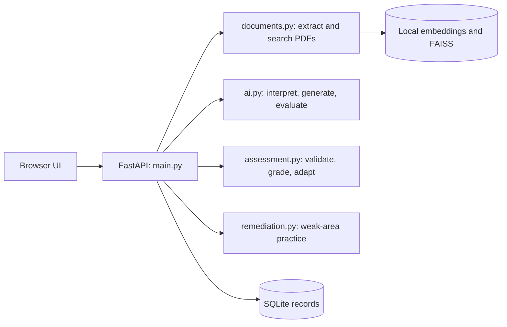

# AdaptiveAI Code Overview

This is a short guide to what each part of the repository does and how they work together. It describes the current implementation, not a line-by-line code walkthrough.

## How the App Works

1. The browser UI in `app/static/` uploads course PDFs and sends requests to the FastAPI routes in `app/main.py`.
2. `app/documents.py` extracts PDF text, splits it into page-linked chunks, creates local embeddings, and saves FAISS indexes.
3. The user describes an assessment. `app/ai.py` turns the prompt into structured settings; `app/assessment.py` checks the settings for conflicts, and the user approves them.
4. For generation, assessment logic retrieves relevant chunks and asks the AI service to write questions. The app validates the question structure, topic, answers, and citations before saving a complete set.
5. The student answers questions one at a time. MCQ and numerical answers are graded by application code; free-text answers are checked by the AI against the rubric and cited material.
6. Assessment and remediation code saves results, adapts eligible unanswered questions, and builds analytics or a new weak-area practice set.



## Project Files

### Root

| File or folder | What it does |
|---|---|
| `README.md` | Project features, setup instructions, user workflow, architecture, configuration, API list, and limitations. |
| `requirements.txt` | Python packages needed to run the service and its tests. |
| `pytest.ini` | Pytest settings for running the test suite. |
| `Dockerfile` | Builds the Python app image and starts one Uvicorn worker. |
| `compose.yaml` | Runs the container, passes environment settings, exposes the web port, and persists app data in a volume. |
| `TEST_RESULTS.md` | Historical test and integration notes, including environment and provider limitations. |
| `data/` | Runtime storage for uploaded PDFs, indexes, and cached embedding models. Treat its contents as private user/application data. |

### Python application (`app/`)

| File | What it does |
|---|---|
| `__init__.py` | Marks `app` as a Python package. |
| `main.py` | Defines the FastAPI app and HTTP endpoints. Coordinates registration/login, PDF uploads, drafts, generation jobs, assessment answers, retries, analytics, and access checks. |
| `ai.py` | Connects to Anthropic for prompt interpretation, question generation, evidence checking, free-text grading, and concept grouping. Also creates local text embeddings with FastEmbed. |
| `documents.py` | Validates PDFs, extracts page text, creates overlapping chunks, builds and saves FAISS indexes, and retrieves relevant chunks for a query. |
| `assessment.py` | Validates interpreted settings and generated questions; plans question generation; grades MCQ and numerical answers; calls AI grading for free text; handles live difficulty adaptation and assessment reports. |
| `remediation.py` | Uses past attempts to group concepts, estimate weak areas, allocate follow-up questions, and compare results between attempts. |
| `models.py` | Defines SQLAlchemy database records: users, documents, pages, chunks, drafts, questions, assessments, responses, and adaptation decisions. |
| `db.py` | Creates the database engine and sessions, configures SQLite behavior, and provides database sessions to API routes. |
| `config.py` | Reads environment settings such as database/storage paths, model names, upload limits, and adaptation thresholds. |
| `security.py` | Hashes passwords, signs and checks expiring login tokens, identifies the current user, and enforces record ownership. |
| `static/index.html` | Minimal HTML shell that loads the browser application and stylesheet. |
| `static/app.js` | Builds the UI, stores temporary browser/session state, calls API endpoints, and renders upload, setup, assessment, history, and analytics screens. |
| `static/style.css` | Styles the interface and adjusts its layout for smaller screens. |

### Tests (`tests/`)

| File | Main area covered |
|---|---|
| `conftest.py` | Shared test setup, fixtures, and deterministic test doubles. |
| `test_ai_provider.py` | AI provider adapter behavior and request/response handling. |
| `test_config.py` | Environment-backed configuration. |
| `test_documents.py` | PDF validation, text chunking, indexing, and retrieval behavior. |
| `test_assessment.py` | Assessment configuration, question checks, grading, adaptation, and analytics. |
| `test_contracts.py` | API contracts, ownership boundaries, and integration behaviors. |
| `test_generation_reliability.py` | Question generation validation, retries, and failure handling. |
| `test_reliability.py` | Reliability cases such as preserving answers and handling failures. |
| `test_remediation.py` | Weak-area planning and attempt comparisons. |

Tests use controlled substitutes for external AI and vector-search dependencies where deterministic behavior is needed; passing those tests does not by itself prove live model quality.

## Important Design Choices

- **Source grounding:** Retrieved PDF chunks carry document and page references. Questions cite chunk IDs, and the app checks those citations before publishing a set.
- **No partial assessment:** If the app cannot generate and validate the complete requested set, it reports failure instead of saving a partial set as ready.
- **Answer privacy:** The question preview omits answer keys and rubrics. They become available for feedback and analytics after submission.
- **Mixed grading:** Objective question types use predictable application-side checks; subjective answers use rubric-based AI evaluation.
- **Recoverable work:** Answers are saved before external grading. Failed grading can be retried with the same answer.
- **Bounded adaptation:** Only eligible, unanswered questions may be replaced. Explicit difficulty constraints and approved formats/topics are respected, and decisions are recorded.
- **Single-server scope:** SQLite and in-process background work are intended for a modest single-server deployment. Scaling to multiple workers or instances requires additional infrastructure.

## Running and Testing

With the project virtual environment activated and dependencies installed:

```powershell
python -m uvicorn app.main:app --reload --port 8000
python -m pytest -q
```

The web app is then available at `http://127.0.0.1:8000`. Model-backed features also require an Anthropic API key in the local environment configuration. Keep that key private and never put it in browser code.